# Split Secondary Firmware Clone — Implementation Plan

- **Date:** 2026-11-12
- **Design doc:** `docs/superpowers/specs/2026-11-12-split-secondary-flash-design.md` (approved 2026-11-12; extended 2026-11-12 with the phased build & validation workflow)
- **Scope:** firmware-only. No host script, no CLI changes, no changes to `util/uf2conv.py`, `platforms/chibios/flash.mk`, or `lib/python/qmk/`.
- **Module location:** `modules/bastardkb/bk_split_flash` in this local folder (the loader searches `modules/`, plural — earlier `module/` wording was a typo, confirmed 2026-11-12) — a standalone QMK Community Module. The human partner may move it (e.g. into external userspace) later.
- **Target board:** `bastardkb/dilemma/4x6_4_procyon` (`vendor` keymap from userspace — confirmed 2026-11-12, see the Workflow contract; the measured `.uf2` in `.build/` is from this board) — the single board for all hardware validation.
- **Build strategy:** standalone QMK Community Module enabled by listing it in `keymap.json`; zero edits to QMK core (§3). Three internal seams — trigger / transport / action — with a HAL boundary so the hardware-bound action and the host-testable protocol can be built in parallel.
- **Status:** Phase 0 **PASSED and complete** (2026-11-12): probe/echo round-trip verified on hardware
  via `qmk console` (see "Phase 0 gate result" below); retrospective written and TLDR confirmed by the
  user; plan updated. **Phase 1 is NOT started — the user will kick it off later.** The module is inert
  unless listed in `keymap.json`; QMK core is still untouched.
- **How to work on this plan:** read `docs/superpowers/phase-execution-instructions.md` at the start of
  each phase (ask-the-user rules, retrospective duties), and check `docs/superpowers/qmk-knowledge-base.md`
  **before** researching any QMK behaviour — add new findings there instead of re-researching.

## 1. What this implements, in one flow

```
user holds bootmagic → primary BOOTSEL → user drops firmware.uf2 → primary reboots
     → primary's new firmware asks secondary "do you support clone, and is your image different?"
     → secondary answers yes + its image fingerprint
     → primary arms ROM fallback on secondary, streams its own firmware region in chunks
     → secondary stages chunks in spare flash, verifies whole image
     → secondary commits in one brief RAM-resident step, writes boot2 last
     → both halves wipe runtime settings and reboot
     → next boot: fingerprints match, module does nothing
```

Only the **primary's** USB is connected. The secondary never enters ROM BOOTSEL in the happy path; it stays in QMK and self-writes its flash. The RP2040 mask-ROM fallback is *armed* (boot2 invalidated) so any interruption lands the chip in an un-erasable recoverable state.

## 2. Verified repo facts this plan relies on

Measured from the working tree, not assumed.

| Fact | Value / location |
|---|---|
| Normal flash path | `platforms/chibios/flash.mk:106` (`BOOTLOADER=rp2040`) → `EXEC_UF2_UTIL_DEPLOY` (`flash.mk:44`) → `util/uf2conv.py --wait --deploy` |
| `.uf2` build | `builddefs/common_rules.mk:223-224` (`$(HEX)` → `.tmp` → `uf2conv.py --convert --family RP2040`); `UF2CONV` at `common_rules.mk:146` |
| UF2 block geometry | 512-byte blocks, 256-byte payload (`util/uf2conv.py:40`) — a `.uf2` is 2x the binary |
| Real image size | `.build/bastardkb_dilemma_4x6_4_procyon_vendor.uf2` = 390,144 B = 762 blocks = **195,072 B (~190 KiB)** of flash payload |
| Platform defaults | `platforms/chibios/mcu_selection.mk:163` `MCU_LDSCRIPT ?= RP2040_FLASH_TIMECRIT`, `:175-176` `UF2_FAMILY=RP2040`, `FIRMWARE_FORMAT=uf2` |
| Flash base / image end | XIP `0x10000000`; `__flash_binary_start` and `__flash_binary_end` at `platforms/chibios/boards/common/ld/RP2040_FLASH_TIMECRIT.ld:95,115`; `.boot2` section at `:98-102` |
| boot2 | 252 bytes code + 4-byte checksum (`lib/pico-sdk/src/rp2_common/boot_stage2/boot2_w25q080.S:26`); image code begins at `0x10000100` (`:94`); ROM validates it on power-on |
| Flash size | `PICO_FLASH_SIZE_BYTES (2*1024*1024)` (`lib/pico-sdk/src/boards/include/boards/pico.h:74`) |
| Emulated EEPROM | `WEAR_LEVELING_BACKING_SIZE` = 8192 B (`wear_leveling_rp2040_flash_config.h:16`), logical 4096 B (`:21`), located at `PICO_FLASH_SIZE_BYTES - 8192` (`:31`) = `0x101FE000` for 2 MiB |
| Free staging space | ~1.8 MiB between `__flash_binary_end` (~`0x1002FA00`) and the EEPROM backing region |
| RAM-resident flash writer precedent | `platforms/chibios/drivers/wear_leveling/wear_leveling_rp2040_flash.c:31-32` (`BOOT2_ROM` copied to `BOOT2_ROM_RAM`), `:40-55` `__no_inline_not_in_flash_func` helpers (`flash_enable_xip_via_boot2`, `flash_cs_force`, `flash_put_get`) |
| Boot / reset hooks | weak `mcu_reset()` = `NVIC_SystemReset()` (`rp2040.c:16`); `bootloader_jump()` = `reset_usb_boot()` (`rp2040.c:19-21`); `soft_reset_keyboard()` (`quantum/quantum.c:237-240`); weak `bootmagic_scan()` (`quantum/bootmagic/bootmagic.c:63-75`) |
| Double-tap recovery | `rp2040.c:25-56` `__late_init()`, `.ram0.bootloader_magic` (`:32`), 200 ms default (`:27`), 500 ms on Dilemma boards (e.g. `dilemma/4x6_4_procyon/config.h:41-43`); enabled across `keyboards/bastardkb/*/config.h` |
| Bootrom interfaces | USB mass storage + USB PICOBOOT only (`pico_bootrom/include/pico/bootrom.h:153-159`); `reset_usb_boot` is `noreturn` (`:161-165`). **No UART/serial flash mode.** |
| Split transaction IDs | `quantum/split_common/transaction_id_define.h:21-131`, `STATIC_ASSERT(NUM_TOTAL_TRANSACTIONS <= (1 << 5))` at `:141` — **max 32 IDs**, near-fully used on a feature-rich board |
| Transaction descriptor | `quantum/split_common/transactions.h:29-35`: `uint8_t initiator2target_buffer_size`, `uint8_t target2initiator_buffer_size` → **255-byte cap per transaction** |
| Registration helpers | `transactions.c:76-89` (`trans_initiator2target_initializer`, `_cb`, `transport_write/read/exec`); table at `:983-1020` with `TRANSACTIONS_*_REGISTRATIONS` macros; `transactions_master()` at `:1022` |
| Handler macros | `transactions.c:116-145` `TRANSACTION_HANDLER_MASTER` (10 retries when connected, `:100-114`), `SLAVE`, `SLAVE_AUTOLOCK` |
| Serial framing | `platforms/chibios/drivers/serial_protocol.c:51-94` (slave thread, 1 KiB working area at `:17`, callback invocation at `:82-84`), `:102-158` (master, XOR handshake `transaction_id ^ NUM_TOTAL_TRANSACTIONS` at `:136`) |
| Half-duplex behaviour | `platforms/chibios/drivers/serial_usart.c:111-144` — every sent byte is echoed and must be drained; `SERIAL_USART_TIMEOUT` 20 ms (`serial_usart.h:43-44`); `serial_vendor.c:133` half-duplex unless `SERIAL_USART_FULL_DUPLEX` |
| Line speed | `SERIAL_USART_SPEED` 230400 default / 460800 max (`serial_usart.h:27-38`); 11 bits per byte (`serial_vendor.c:155`) → ~20.9 KiB/s raw |
| Existing per-transaction checksums | `platforms/chibios/drivers/serial.c:164-196,243-273` (sum ^ 7) |
| Watchdog | `quantum/split_common/split_util.c:84-122`, `split_watchdog_task()` → `mcu_reset()` at `:118` on the slave after `SPLIT_WATCHDOG_TIMEOUT` |
| Periodic hook | weak `housekeeping_task_kb()` (`quantum/keyboard.c:424`, called at `:439`); `housekeeping_task()` in the main loop (`quantum/main.c:75`) — runs on **both** halves |
| EEPROM API | `eeconfig_init()`, `eeconfig_enable()`, `eeconfig_disable()` (`quantum/eeconfig.h:58-64`) |
| Handedness | `SPLIT_HAND_PIN` in BKB `config.h` files; **no `EE_HANDS`** anywhere under `keyboards/bastardkb/`; `uf2-split-left/right` (`platforms/chibios/flash.mk:50-64`) not needed |
| VBUS helper | `usb_vbus_state()` (`tmk_core/protocol/usb_util.h:25`) |

### Additional verified facts — the standalone Community Module path (added 2026-11-12)

Measured in-tree; these are why the plan needs no QMK core edits.

| Fact | Value / location |
|---|---|
| Community Modules supported | `docs/features/community_modules.md`; example modules under `modules/qmk/` (e.g. `modules/qmk/split_data_sync/`) |
| Module enablement | `"modules": [ "<path>" ]` in `keymap.json` (`community_modules.md:18-26`); discovers modules under `modules/` (`community_modules.md:11-14`) |
| Module files auto-included | `qmk_module.json`, `config.h`, `rules.mk`/`post_rules.mk`, `<module>.c` (`community_modules.md:67-112`) |
| Split transaction IDs from a module | `#define SPLIT_TRANSACTION_IDS_MODULE_<MOD> <ID>` in `config.h` → generated `split_transaction_id_community_modules.inc` injected into the enum (`transaction_id_define.h:128-131`; `lib/python/qmk/cli/generate/community_modules.py:548-561`) |
| `SPLIT_TRANSACTION_RPC` auto-defined | `community_modules.py:359-367` defines it when a module declares a split transaction ID |
| RPC registration / invocation | `transaction_register_rpc()` (`transactions.c:1071`, declared `transactions.h:48`) in `keyboard_post_init_<mod>()`; `transaction_rpc_exec/send/recv` (`docs/features/split_keyboard.md:385-390`); working example `modules/qmk/split_data_sync/split_data_sync.c:24-42` |
| RPC buffer sizes | `RPC_M2S_BUFFER_SIZE` / `RPC_S2M_BUFFER_SIZE`, default 32, overridable in `config.h`, `uint8_t`-sized (`transport.h:27-33`, `split_keyboard.md:393-400`); buffers live in `split_shared_memory_t` (`transport.h:239-243`) |
| RPC base transaction IDs | `PUT_RPC_INFO`, `PUT_RPC_REQ_DATA`, `EXECUTE_RPC`, `GET_RPC_RESP_DATA` (`transaction_id_define.h:111-116`) — 4 IDs, always added when RPC is on |
| Housekeeping / post-init hooks | `housekeeping_task_<mod>()` and `keyboard_post_init_<mod>()` (API 1.0.0 / 0.1.0, `community_modules.md:165-170`); `housekeeping_task_modules()` runs on both halves (`keyboard.c:415-443`) |
| API version guard | `ASSERT_COMMUNITY_MODULES_MIN_API_VERSION(1,1,2)` — split-transaction support needs ≥ 1.1.2 (`community_modules.md:115`, example `split_data_sync.c:8`) |
| Watchdog hooks (public) | `split_watchdog_update(bool)` / `split_watchdog_init()` (`split_util.h:14-15`); `split_watchdog_task()` is **not** weak (`split_util.c:113-119`) |
| I2C shared-memory assert | `STATIC_ASSERT(sizeof(split_shared_memory_t) <= I2C_SLAVE_REG_COUNT)` is inside `#ifdef USE_I2C` (`transport.c:32-40`) — not triggered on serial |

**Hard constraints derived from the above:**

1. A single transfer cannot exceed **255 bytes**. "Send big data packages / use all available RAM" is not possible through the stock split transport, and buffering a 190 KiB image in the RP2040's 264 KiB SRAM would starve QMK. Chunking is mandatory; RAM is only used for the small RAM-resident writer and one chunk buffer. The module path hits the same ceiling: `RPC_M2S_BUFFER_SIZE`/`RPC_S2M_BUFFER_SIZE` are `uint8_t`.
2. The transaction-ID budget is **32** (`transaction_id_define.h:141`). The standalone module adds its ID via `SPLIT_TRANSACTION_IDS_MODULE_*`, but that enables RPC, which adds **4 base IDs plus N module IDs** — a larger footprint than the single multiplexed ID a core edit would have added. **Phase 0 must compile-check `NUM_TOTAL_TRANSACTIONS <= 32` on the target board**; if it trips, trim other split sync features or (last resort) make the one guarded core edit.
3. The half-duplex wire at 230400 baud is the throughput bottleneck; ~190 KiB with per-chunk framing, echo draining and ACKs lands in the **20–40 s** range. RPC's 4-phase handshake per chunk (info → req data → execute → resp data) is slower than a hand-packed single transaction, so windowed ACKs / chunk tuning matter more; speed tuning is a link-setting decision, not a RAM decision.
4. `util/uf2conv.py:359-370` loops over *all* mounted UF2 drives. If a user ever connects both halves, both get flashed by one `qmk flash`; the clone must skip when fingerprints match so it does not duplicate that work.
5. `RPC_M2S_BUFFER_SIZE` is a **global** macro: raising it to ~246 enlarges `split_shared_memory_t` for every RPC user in the build. Safe on serial (the I2C `STATIC_ASSERT` is gated on `USE_I2C`), but confirm in the Phase 0 build.

## 3. Module layout and build integration (standalone Community Module)

**Location (provisional):** `module/bastardkb/bk_split_flash` in this local folder; movable into external userspace later. QMK's loader discovers modules under `modules/` (plural) — see the Phase 0 caveat — so this path/enablement is confirmed before any other code is written.

New folder, isolated, following `modules/qmk/split_data_sync/`:

```
modules/bastardkb/bk_split_flash/
    qmk_module.json            module_name, maintainer, license; ASSERT_COMMUNITY_MODULES_MIN_API_VERSION(1,1,2)
    config.h                   SPLIT_TRANSACTION_IDS_MODULE_*, RPC_*_BUFFER_SIZE, config knobs, compile-time asserts
    rules.mk                   SRC += bk_split_flash_flash.c; any pico-sdk flash include paths
    bk_split_flash.c           TRIGGER + TRANSPORT: probe/fingerprint, master & slave state machines, packet/CRC/retry (host-testable)
    bk_split_flash_flash.c     ACTION: RP2040 staging/verify/commit, RAM-resident writer (the only hardware-bound file)
    bk_split_flash.h           seam definitions, opcodes, packet/state structs, the HAL boundary between .c and .flash.c
    README.md                  seed-flash, recovery, "settings wiped every update", validation notes
```

The **three seams** from the design map onto these files: trigger + transport live in `bk_split_flash.c`, action in `bk_split_flash_flash.c`, and `bk_split_flash.h` is the HAL boundary. This lets the hardware-bound action and the host-testable protocol/state-machine be developed in parallel (e.g. separate worktrees/sessions); the non-flash logic gets a native harness with no RP2040 and no 20–40 s serial loop.

### Former core edits → Community Module hooks (zero core edits)

The plan's original "guarded core edits" are replaced by first-class module hooks:

| Original core edit | Standalone-module equivalent |
|---|---|
| `transaction_id_define.h` add `PUT_SPLIT_FLASH` | `#define SPLIT_TRANSACTION_IDS_MODULE_BK_SPLIT_FLASH <ID>` in `config.h` → generated `split_transaction_id_community_modules.inc` (`transaction_id_define.h:128-131`) |
| `transactions.c` table registration | `transaction_register_rpc(ID, slave_cb)` in `keyboard_post_init_bk_split_flash()` (`transactions.c:1071`) |
| `transport.h` shared-memory field | RPC's `rpc_m2s_buffer`/`rpc_s2m_buffer` (`transport.h:239-243`), sized via `RPC_M2S_BUFFER_SIZE`/`RPC_S2M_BUFFER_SIZE` in `config.h` |
| `keyboard.c` / `main.c` housekeeping | `housekeeping_task_bk_split_flash()` (`keyboard.c:415-443`), runs on both halves |
| `common_features.mk` / `post_config.h` flag wiring | `qmk_module.json` + auto-included `config.h` / `rules.mk`; opt-in = one `"modules": [ ... ]` entry in `keymap.json` |
| `split_util.c` watchdog early-return | public `split_watchdog_update()` / `split_watchdog_init()` (`split_util.h:14-15`); `split_watchdog_task()` is not weak. **Phase 0 decides** whether these suffice or one guarded core line is unavoidable — the only possible core edit. |

**Enablement:** the module is inert unless listed in `keymap.json`; "flag off = stock build" is achieved by not listing it, with no `#ifdef` threaded through QMK core. `ASSERT_COMMUNITY_MODULES_MIN_API_VERSION(1,1,2)` guards compatibility.

**Config knobs (`config.h`, overridable by the keyboard/keymap):**

| Knob | Default | Purpose |
|---|---|---|
| `SPLIT_TRANSACTION_IDS_MODULE_BK_SPLIT_FLASH` | `PUT_BK_SPLIT_FLASH` | the module's split transaction ID |
| `RPC_M2S_BUFFER_SIZE` / `RPC_S2M_BUFFER_SIZE` | `246` / `16` | m2s packet (opcode+seq+len+240 payload+CRC) / capability+ACK response; global RPC macros |
| `SPLIT_FLASH_STAGING_OFFSET` | `0x100000` (1 MiB from XIP base) | start of spare staging region |
| `SPLIT_FLASH_MAX_IMAGE_SIZE` | `256 * 1024` | bounds the staging slot and rejects oversized images |
| `SPLIT_FLASH_CHUNK_SIZE` | `240` | payload bytes per transaction (leaves room for opcode/seq/CRC in 255) |
| `SPLIT_FLASH_HANDSHAKE_TIMEOUT` | `100` ms | capability probe timeout |
| `SPLIT_FLASH_TRANSFER_TIMEOUT` | `60` s | whole-transfer bound (the anti-"appears hung" guard) |
| `SPLIT_FLASH_FORCE` | off | optional "force re-clone" escape hatch |

**Compile-time asserts (in `bk_split_flash.h` / `config.h`):**

- `!defined(EE_HANDS)` — one image must be valid for both halves; fail the build with a clear message otherwise.
- `!defined(USE_I2C)` — serial transport only.
- RP2040 platform guard (use the same platform define as `platforms/chibios/mcu_selection.mk`).
- `SPLIT_FLASH_CHUNK_SIZE + header <= 255` (and `RPC_M2S_BUFFER_SIZE` matches it).
- `SPLIT_FLASH_STAGING_OFFSET + SPLIT_FLASH_MAX_IMAGE_SIZE < (PICO_FLASH_SIZE_BYTES - WEAR_LEVELING_BACKING_SIZE)`.
- `NUM_TOTAL_TRANSACTIONS <= 32` — asserted at `transaction_id_define.h:141`; **verify with a real compile in Phase 0** (RPC adds 4 base IDs).

**No changes to:** any QMK core file (the point of the standalone module), nor `qmk flash`, `qmk compile`, `lib/python/qmk/cli/flash.py`, `qmk/flashers.py`, `util/uf2conv.py`, `platforms/chibios/flash.mk`, `UF2_FAMILY`, `FIRMWARE_FORMAT`, or any bootloader target. `qmk flash` with the plain `rp2040` bootloader (`flash.mk:106`) and a manual UF2 drag both remain valid; `flash.py:62` passes `-bl` straight to make, so a future `uf2-split-both` target would need no Python change if one is ever wanted.

## 4. Flash layout and the safety model

```
0x10000000  +---------------------------+
            | boot2 (256 B, +4B checksum) |  <- ROM validates on every power-on
0x10000100  | vector table / image ...    |
            | ...                        |
&__flash_binary_end (~0x1002FA00, ~190 KiB)
            |                           |
            |  free (~1.8 MiB)          |
0x10100000  +---------------------------+
            | STAGING SLOT (256 KiB)     |  <- new image written here first
            |                           |
            |  free ...                 |
0x101FE000  +---------------------------+
            | emulated EEPROM (8192 B)  |  <- excluded from clone; wiped on success
0x10200000  +---------------------------+
```

**The ROM-fallback trick.** The RP2040 bootrom validates boot2's 4-byte checksum (`boot2_w25q080.S:26`) on power-on and stays in BOOTSEL USB mass storage if it is invalid. Therefore:

1. **Arm:** erase the 4 KiB sector at flash offset 0, invalidating boot2. From this moment until the final write, any reset/power-cycle automatically lands the secondary in the un-erasable BOOTSEL state — no working firmware, no double-tap, no QMK required.
2. **Stage:** write chunks into the staging slot. Old firmware in the active region is untouched and bootable until step 4.
3. **Verify:** CRC over the whole staged image plus length/magic checks.
4. **Commit:** one RAM-resident, interrupts-off section — erase active sectors `[0, image_end)`, copy staging → active page by page, and **write boot2 last**. Its checksum doubles as the "valid" marker, so no separate marker is needed and no module state needs to live in EEPROM (which we wipe).
5. **Wipe + reboot.**

| Interruption point | State on next power-on | Recovery |
|---|---|---|
| Before arm | old firmware intact | none; retry next boot |
| After arm, during staging | boot2 invalid → ROM auto-BOOTSEL | plug secondary USB, drop UF2 |
| During commit | boot2 still invalid (written last) → ROM auto-BOOTSEL | plug secondary USB, drop UF2 |
| After boot2 written, before reboot | complete image boots normally | next boot fingerprints match → skip; the settings wipe may be skipped in this tiny window (harmless, see §9) |
| After reboot | both halves on new firmware | none |

The "danger window" is thus reduced to the brief final RAM-resident commit, and even an interruption there is auto-recoverable. Double-tap reset (`rp2040.c:25-56`, 200/500 ms windows, enabled on all BKB boards) and `bootloader_jump()` remain the documented manual escape hatch. **Recovery requires a USB cable to the secondary once** — the accepted consequence of the one-cable topology.

Writer implementation: reuse the pattern in `wear_leveling_rp2040_flash.c` — `__no_inline_not_in_flash_func`, boot2 copied to `BOOT2_ROM_RAM`, chip-select forced via IO overrides, XIP re-enabled via the RAM copy. All erase/program code and every function it calls must be RAM-resident; `pico-sdk`'s `hardware/flash.h` (`flash_range_erase`, `flash_range_program`) are the primitives. Never erase a 4 KiB sector while executing from it.

## 5. Fingerprint and capability handshake

**No sticky "just flashed" flag, no build-ID injection, no post-build script.** Both halves compute a CRC at runtime over their own active image region `[XIP_BASE, &__flash_binary_end)` using the linker symbol at `RP2040_FLASH_TIMECRIT.ld:115`. QMK already ships CRC helpers (`crc8` used at `transactions.c:150`); use a 32-bit CRC for a 190 KiB image. Reading flash via XIP while executing from it is a plain memory read — safe.

The primary sends one capability probe containing: protocol version, its image length, and its image CRC. The secondary replies with the same. Decision:

- no reply / timeout → **skip** (this is the old-firmware seed case),
- protocol version mismatch → **skip**,
- CRC equal and length equal → **skip** (no re-clone; self-healing after an interrupted attempt),
- otherwise → begin transfer.

**Why an old secondary safely skips:** its `NUM_TOTAL_TRANSACTIONS` is smaller, so the new `PUT_SPLIT_FLASH` ID is rejected at `serial_protocol.c:59-61` / `:115-118`, and the XOR handshake at `:136` uses a different constant → `transport_execute_transaction` returns false. Bounded by `SPLIT_FLASH_HANDSHAKE_TIMEOUT`; the primary's boot is never blocked. With the standalone module the ID is `SPLIT_TRANSACTION_IDS_MODULE_BK_SPLIT_FLASH` (RPC-wrapped): old firmware without the module lacks the RPC handlers and the matching transaction table, so the probe simply fails and skips — same outcome, confirmed in Phase 0.

## 6. Transport: one multiplexed transaction (delivered as a Community Module)

**Decision: one module transaction ID, multiplexed by an opcode byte.** The original core-edit plan added `PUT_SPLIT_FLASH` directly to the transaction table. As a standalone Community Module, QMK core cannot be edited, so the ID is declared with `#define SPLIT_TRANSACTION_IDS_MODULE_BK_SPLIT_FLASH PUT_BK_SPLIT_FLASH` (`config.h` → generated `.inc`, `transaction_id_define.h:128-131`) and registered with `transaction_register_rpc(ID, slave_cb)` in `keyboard_post_init_bk_split_flash()` (`transactions.c:1071`). This still yields **one** logical ID carrying an opcode byte (the packet layout below is unchanged), but QMK's RPC transport wraps it with 4 base IDs (`PUT_RPC_INFO/REQ_DATA/EXECUTE_RPC/RESP_DATA`, `transaction_id_define.h:111-116`) and its own `rpc_m2s_buffer`/`rpc_s2m_buffer` (`transport.h:239-243`) sized by `RPC_M2S_BUFFER_SIZE`/`RPC_S2M_BUFFER_SIZE` in `config.h`. The 255-byte cap is unchanged (`uint8_t` sizes). **The 32-ID budget under RPC is the top Phase 0 caveat** (`transaction_id_define.h:141`): if enabling the module trips `NUM_TOTAL_TRANSACTIONS <= 32` on the procyon, trim other split sync features or (last resort) make the single guarded core edit — this is why Phase 0 compiles the barebones image first.

The slave callback (`slave_callback_t`, `transactions.h:26`) is invoked by QMK's RPC `EXECUTE_RPC` path; the module drives its own state machine from `housekeeping_task_bk_split_flash()` (see below), not from `TRANSACTION_HANDLER_MASTER`.

**Packet layout within 255 bytes** (master → slave):

```
opcode   : 1   CAP_QUERY | BEGIN | CHUNK | VERIFY | WIPE | ABORT | STATUS
seq      : 2   chunk sequence number (0..N-1)
len      : 1   payload length
payload  : <= SPLIT_FLASH_CHUNK_SIZE (240)
crc      : 2   over the packet
```

**Response** (target2initiator, same buffer or a small sibling): `status (1) | seq (2) | crc (2)` — an explicit ACK/NACK per chunk. `transport_execute_transaction` already returns `bool` from `soft_serial_transaction` (`transport.c:111`), and `serial.c:164-196,243-273` adds a per-transaction checksum, so integrity is layered: framework checksum + packet CRC + explicit ACK.

**Retry policy:** bounded per-chunk retransmission (e.g. 3), a global `SPLIT_FLASH_TRANSFER_TIMEOUT`, and a clean `ABORT` that leaves the armed state intact (which is the recoverable state). Do **not** use `TRANSACTION_HANDLER_MASTER` (`transactions.c:116-119`) for the transfer — its generic 10-retry wrapper (`:100-114`) is designed for small per-scan transactions and would make a long transfer unbounded.

**Where the state machines run:** `housekeeping_task_bk_split_flash()` (Community Module hook, `keyboard.c:415-443`, on **both** halves). Master side gated by `is_keyboard_master()`; slave side gated by the complement. Long operations (erase/commit/wipe/reboot) are **deferred out of the RPC callback**: a multi-second RAM-resident commit must not run inside `split_flash_slave_callback`. The callback only copies the chunk into a small buffer and sets a deferred flag; the housekeeping task performs the flash work.

`SPLIT_WATCHDOG_ENABLE`: rather than editing `split_watchdog_task()` (`split_util.c:113-119`, not weak), the module calls the public `split_watchdog_update()` / `split_watchdog_init()` (`split_util.h:14-15`) from its housekeeping loop while busy, so the slave does not reset itself mid-erase. **Phase 0 confirms this suffices**; if not, the one guarded core edit is the plan's only unavoidable core change.

## 7. Master state machine

```mermaid
stateDiagram-v2
    [*] --> Idle
    Idle --> Probe: housekeeping, master, one-shot guard not set
    Probe --> Idle: no reply / mismatch / identical CRC
    Probe --> Begin: reply OK + CRC differs
    Begin --> Streaming: slave ACKs BEGIN (armed)
    Streaming --> Streaming: CHUNK n, wait ACK, retransmit<=3
    Streaming --> Abort: timeout / NACK exhausted
    Streaming --> Verify: last chunk ACKed
    Verify --> Wipe: slave reports CRC match
    Wipe --> Reboot: both settings wiped
    Reboot --> [*]: mcu_reset()
    Abort --> Idle: bounded; never blocks boot
```



- One-shot guard: a static flag in the module, set once per boot after a completed or skipped decision. Because EEPROM is wiped, **no persistent state is stored in EEPROM**; the fingerprint comparison itself is the persistent state.
- Progress indication: bounded and visible via existing debug/LED hooks (`dprintf`, `RP2040_BOOTLOADER_DOUBLE_TAP_RESET_LED GP17` is available on BKB boards). No custom USB interface.
- The primary tolerates the secondary disappearing at the final reboot; no blocking wait.
- `bootloader_jump()` / `reset_usb_boot()` is **not called in the happy path** — consistent with "no boot mode on the secondary". It remains the recovery mechanism reachable via QK_BOOT, bootmagic, and double-tap, which satisfies "use QMK mechanisms like that bootload function" without invoking it during a clone.

## 8. Slave state machine

1. `split_flash_slave_callback` receives `CAP_QUERY` → compute CRC over its own `[XIP_BASE, &__flash_binary_end)`, fill the response buffer (version, length, CRC). No flash writes.
2. `BEGIN` → mark busy, pause watchdog, **erase sector 0 (arm ROM fallback)**, erase the staging slot. Deferred to housekeeping; ACK immediately after the erase completes.
3. `CHUNK n` → verify packet CRC and sequence, write `len` bytes into the staging slot at `offset = n * CHUNK_SIZE` via the RAM-resident writer, ACK with `seq`. Out-of-order or duplicate → NACK with expected `seq`.
4. `VERIFY` → compute CRC over the staged image, compare against the master's advertised CRC and length; also check `len <= SPLIT_FLASH_MAX_IMAGE_SIZE` and a magic header. Report match/mismatch.
5. On match, deferred **commit**: RAM-resident, interrupts off, erase active region, copy staging → active, write boot2 last.
6. `WIPE` → `eeconfig_init()` (`quantum/eeconfig.h:58`) on the secondary.
7. `mcu_reset()` (`rp2040.c:16`, weak `NVIC_SystemReset`).

Every flash operation is idempotent-ish: a repeated `CHUNK` with the same `seq` rewrites the same bytes; a repeated `VERIFY` recomputes; a repeated `BEGIN` re-erases staging (safe, because boot2 was already armed and the old active image is still intact until commit).

## 9. Wiping both halves (human decision)

- Primary: after receiving the slave's `WIPE` ACK, call `eeconfig_init()` locally, then `mcu_reset()`.
- Secondary: `eeconfig_init()` in its housekeeping task on the `WIPE` opcode.
- **Consequence, documented in the module README:** runtime settings (layer state, default layer, RGB/backlight config, debug flags) reset on *every* update. Keymaps live in flash and are unaffected. Handedness is unaffected because BKB boards use `SPLIT_HAND_PIN`, not `EE_HANDS` — verified: no `EE_HANDS` under `keyboards/bastardkb/`.
- **EEPROM region is excluded from the cloned image** anyway (it lives at `0x101FE000`, well beyond `__flash_binary_end`). The wipe is an explicit act, not a side effect of copying flash.
- **Residual window:** if power is cut between the final boot2 write and the wipe, the new firmware boots with old settings. Accept this as harmless; do not add persistent state in EEPROM to "fix" it, since that state would itself be wiped. Optionally make the wipe idempotent by re-issuing it on the next boot if a small flash-metadata flag (not EEPROM) says the clone completed.

## 10. Speed analysis and the "use all available RAM" objective

| Quantity | Value |
|---|---|
| Image payload | 195,072 B |
| Chunk payload @ 240 B | 813 chunks |
| Raw link | 230400 baud / 11 bits = ~20.9 KiB/s |
| Half-duplex overhead | every sent byte is echoed and drained (`serial_usart.c:114-134`), plus 1-byte ID, 1-byte XOR handshake, ACK bytes, 20 ms `SERIAL_USART_TIMEOUT` per transaction |
| Realistic wall time | **~20–40 s**; ~10–20 s at 460800 |
| RAM needed | one 255-byte chunk buffer + ~1 KiB RAM-resident writer; QMK keeps the rest of the 264 KiB |

**Conclusion:** RAM is not the lever. "Big data packages" are capped at 255 bytes by `transactions.h:29-35`; exceeding that requires changing `split_transaction_desc_t` sizes to `uint16_t` (a broad core change) or bypassing the split transport with a custom protocol (contradicts "SIMPLE"). Recommended speed levers, in order:

1. Keep chunks at the largest size the half-duplex driver's FIFO comfortably handles (start at 64–128 B for the `HAL_USE_SERIAL` echo path in `serial_usart.c:114-134`, tune up to 240 B after measurement; the SIO path at `:135-143` warns about RX FIFO overflow on large transactions).
2. Group ACKs (window of 4–8 chunks) once per-chunk reliability is proven — reduces turnaround without losing retransmission.
3. Optional, later: `SELECT_SOFT_SERIAL_SPEED 0` / `SERIAL_USART_SPEED 460800` (`serial_usart.h:27-38`); `SERIAL_USART_FULL_DUPLEX` boards (`splinktegrated_rev3/config.h`) naturally do better.
4. Never buffer the whole image in RAM; stream straight from XIP flash into staging flash.

The transfer pauses normal matrix/key-report traffic; keep it bounded by `SPLIT_FLASH_TRANSFER_TIMEOUT` and show progress so it does not look like a hang.

## 11. Seed flash and capability gating (human decision)

- Existing boards whose secondary runs old firmware cannot be reached: no receiver, no USB, and the RP2040 bootrom has no serial flash mode (`bootrom.h:153-159`). Accept a **one-time manual seed**: plug the secondary's USB in once, trigger double-tap BOOTSEL, drop the UF2. From then on every future primary flash clones automatically.
- Until seeded, the module's capability probe simply times out and skips; the keyboard works exactly as before (one half updated, one old). Never block, never error loudly.
- Document the seed step in the module README and in the board docs. Keep `bootloader_jump()` / double-tap as the documented path.

## 12. Testing and verification

Hardware verification is not executed by the agent: it is performed by the human partner at each phase's **validation gate** (§13 and the Workflow contract) on the **dilemma 4x6 procyon**, one UF2 per phase. The checks below are the union of those gate checklists plus agent-run build/native-harness checks.

**Build checks**

- `qmk compile -kb bastardkb/dilemma/4x6_4_procyon -km vendor` with the module **listed**; confirm the `.uf2` stays well under `SPLIT_FLASH_MAX_IMAGE_SIZE` and `NUM_TOTAL_TRANSACTIONS <= 32` passes with RPC enabled (`transaction_id_define.h:141`). **No per-phase flag-off control build** (decided 2026-11-12): all our code lives in `modules/bastardkb/bk_split_flash`, so "module not listed" simply means that folder is not compiled → stock by construction; a separate empty build adds nothing. Flag-off remains the documented rollback story in Phase 4, not a build to run.
- Compile a board with `SPLIT_WATCHDOG_ENABLE` (e.g. `keyboards/keychron/q11/config.h:37`) to verify the guarded early return compiles.
- Compile a board with `EE_HANDS` to confirm the compile-time assert fires with a clear message.
- Confirm `qmk flash` and `util/uf2conv.py --deploy` behaviour is byte-for-byte unchanged (no diff to those files).

**Hardware matrix**

- Half-duplex vendor serial (`SERIAL_DRIVER = vendor`, 230400) — the primary target.
- Full-duplex (`SERIAL_USART_FULL_DUPLEX`, `splinktegrated_rev3/config.h`).
- With and without `SPLIT_WATCHDOG_ENABLE`.
- Old secondary firmware (skip path) and seeded secondary (clone path).

**Functional checks**

- After one `qmk flash` of the primary, the secondary's image CRC equals the primary's.
- Both halves' runtime settings are reset; handedness is still correct (`SPLIT_HAND_PIN`).
- Second boot does **not** re-clone (fingerprints match).
- Manual UF2 drag and QMK Toolbox both work, not just `qmk flash`.
- If both halves' USB are ever connected, `uf2conv.py:359-370` flashes both drives and the clone skips (no duplicate work).
- `qmk console` / `dprintf` shows bounded progress and a clean abort on a deliberately disconnected secondary.

**Power-cut injection — the most important test.** Cut power at each point in §4's table (before arm, mid-stream, mid-commit, after boot2, after reboot) and verify that plugging the secondary's USB into the PC and power-cycling yields a BOOTSEL drive that accepts a UF2. Also verify the double-tap path. This is what substantiates "unbrickable".

**Rollback:** since the module is opt-in via `keymap.json` and QMK core is untouched, removing the module entry and reflashing returns the board to stock behaviour with no residual flash changes other than the (harmless) staged data and wiped settings.

## Workflow contract — one UF2 and one validation gate per phase

This applies to every phase in §13 and is the mechanism for working efficiently with hardware the agent cannot touch.

- **Process rehearsal first.** Before each phase, read `docs/superpowers/phase-execution-instructions.md`
  (phase start checklist, ask-the-user rule, retrospective/plan-update duties) and check
  `docs/superpowers/qmk-knowledge-base.md` before researching anything QMK. Extend the knowledge base with
  new findings instead of re-researching.
- **One UF2 per phase.** Each phase delivers exactly **one** self-contained UF2 for
  `bastardkb/dilemma/4x6_4_procyon`, produced by `qmk compile -kb bastardkb/dilemma/4x6_4_procyon -km vendor`
  (confirmed 2026-11-12: the board's real image is the userspace `vendor` keymap, which already lists the
  module and has `CONSOLE_ENABLE = yes`; the in-tree `default` keymap is a bare C keymap with no
  `keymap.json`, so it is not used for phase UF2s). Copied from `.build/` and given a phase label for
  handover. Any temporary test harness (a debug keycode, a forced opcode, a canned image) is compiled into
  that same image, so validation never needs a second image or a host tool. No other flashable artifacts are
  produced mid-phase.
- **Module location:** `modules/bastardkb/bk_split_flash/` (plural `modules/`; the plan's `module/` wording
  was a typo — the loader only searches `modules/`).
- **Each phase ends at a human validation gate.** Flashing and power-cut testing require the physical board, so the agent cannot self-verify them. At the gate the agent provides the UF2 plus an exact checklist and **stops**: no coding for the next phase begins until the human partner reports the result.
- **What the agent hands over at every gate** (spelled out per phase in §13):
  1. the single UF2 (path/name) and the exact build/flash command;
  2. the required hardware state — which USB cable(s) are connected (normally **primary only**), whether the secondary has been **seeded** with the same image or is on old firmware, and any recovery cable needed;
  3. the exact actions to perform (flash, observe, power-cut points, reboot);
  4. the exact observations/evidence to capture — `qmk console` / `dprintf` lines, LED progress indication, presence of a BOOTSEL drive, CRC values, timings;
  5. the exact pass/fail report to send back.
- The human partner validates on the **dilemma 4x6 procyon** and reports PASS/FAIL with evidence; on PASS the agent proceeds to the next phase, on FAIL the phase is revisited before any new work.
- **Phase 0 is also the process rehearsal.** It deliberately runs this whole loop once at the lowest possible cost. Its real output is twofold: it retires the phase-0 caveats, and it proves the workflow itself — that the checklist/gate instructions are clear enough that phases 1–5 can follow the same pattern without re-tuning. Phase 0 ends with a written retrospective that updates these plans (see Phase 0 below).
- Phases 0–3 need the **seed flash** of the secondary once (per §11); the gate checklists state when to do it. Recovery (double-tap / manual UF2 on the secondary) stays available throughout.

**Workflow refinements from the Phase 0 retrospective (confirmed by the user, 2026-11-12):**

- **Phase UF2s must not depend on edits to the userspace `vendor` keymap** (it is user-owned). Temporary
  test hooks/debug keycodes belong *inside the module build* (this repo) or the phase's own repo keymap,
  added deliberately per phase — never as stray references in user-owned keymap files. (Phase 0 was
  briefly blocked by a `BKSFTRG`/`BKSF_TEST_*` machinery in the userspace that no module defined; reverted
  with approval.)
- **Gate checklists state that probe/echo logs are unconditional** (`print`/`xprintf`, no device-debug
  toggle needed) and that **the echoed packet content itself is the slave-side evidence** (a missing
  slave-side "housekeeping on slave half" line is not a failure — console relay to the master may be off).
- **Process:** max **2 different attempts** per objective, then stop, ELI5 what/why/what failed, and ask
  the user for advice (see `phase-execution-instructions.md`, "Stuck / repeated attempts").
- **Ask for evidence/scope, don't guess:** when in doubt, ask the user a question that surfaces raw
  evidence or clarifies scope rather than proceeding on an assumption
  (`phase-execution-instructions.md`, "Ask the user — don't assume").
- **Consume-only evidence + proved-by-construction:** gate checklists ask only for evidence a decision
  uses; a passed compile-time assert is already proof (don't re-derive). Verify observability (e.g. in
  `qmk console`, no hidden debug toggle) before each gate
  (`phase-execution-instructions.md`, "Gate evidence & checklists").
- **No per-phase flag-off control builds** (all code lives in `modules/bastardkb/bk_split_flash`; module
  absent = that folder not compiled = stock by construction). One-off run in Phase 0 confirmed it; retired.

## 13. Phase breakdown (one UF2 + validation gate each)

Every row produces exactly one UF2 for `bastardkb/dilemma/4x6_4_procyon` and stops at the validation gate described below; the agent proceeds only on a PASS report from the human partner. UF2 names below are handover labels for that single `qmk compile` output.

| Phase | Deliverable | UF2 artifact | Exit criterion |
|---|---|---|---|
| 0 — Walking skeleton / verify foundation | Standalone Community Module scaffold (`qmk_module.json`, `config.h`, `rules.mk`), one RPC ID, capability probe + echo in both directions, no flash writes; retire the caveats; rehearsal of the workflow | `bk_split_flash_phase0.uf2` | Compiles with the module enabled; `NUM_TOTAL_TRANSACTIONS <= 32` holds; probe/echo round-trips on both halves; checklist proven usable; plan updated after retrospective — **DONE 2026-11-12** |
| 1 — Safety core | `bk_split_flash_flash.c`: staging erase/program, RAM-resident writer, boot2 arm/last-write, commit, CRC verify; HAL + native test harness; temporary on-device test hook | `bk_split_flash_phase1.uf2` | Power-cut matrix passes on one board; recovery yields a BOOTSEL drive every time |
| 2 — Handshake | Capability/fingerprint probe, runtime CRC over own image, skip policy, one-shot guard | `bk_split_flash_phase2.uf2` | Old secondary skipped cleanly; identical fingerprints skip; no re-clone loop |
| 3 — Transfer | Chunked numbered packets, CRC, ACK/NACK, retransmission, windowing, timeouts, watchdog pause, progress, both-halves wipe + reboot | `bk_split_flash_phase3.uf2` | Full 190 KiB clone completes within `SPLIT_FLASH_TRANSFER_TIMEOUT` on half-duplex |
| 4 — Packaging | Finalize knobs/asserts, README, board docs, seed-flash & recovery instructions; flag-off = stock check | `bk_split_flash_phase4.uf2` (first release candidate) | Module off = stock build; module on = documented; `qmk compile` clean; stock flash paths unchanged |
| 5 — Optional tuning | 460800 baud trial, windowed ACKs, full-duplex tuning | `bk_split_flash_phase5.uf2` | Measured improvement without reliability regressions |

### Phase 0 — Walking skeleton / verify the foundation (NEW; keep it fast)

Build the **barebones image**: the minimal Community Module that compiles in-tree, registers one RPC transaction ID, and round-trips a capability probe + echoed packet between primary and secondary on the dilemma 4x6 procyon, logging to console. **No flash writes, no boot2 changes, no risk to the board.** A minimal `qmk_module.json`/`config.h`/`rules.mk` scaffold exists here; §3 is finalized in Phase 4.

**Deliberately small and fast.** Phase 0 is scoped to the minimum that exercises the wiring — copy the `modules/qmk/split_data_sync/` pattern, add no design work, no packet protocol beyond the probe/echo, and no flash code. The target is an agent-side build measured in hours, not days. It exists to *prove the foundation and the process*, so it must not balloon.

Caveats retired in this phase (each a compile- or console-check in the Phase 0 build):

1. `NUM_TOTAL_TRANSACTIONS <= 32` still passes with the module (RPC's 4 base IDs + 1 module ID).
2. `RPC_M2S_BUFFER_SIZE` / `RPC_S2M_BUFFER_SIZE` override builds cleanly, `split_shared_memory_t` fits, I2C `STATIC_ASSERT` not triggered (serial).
3. Module discovery/enablement works from the provisional `modules/bastardkb/bk_split_flash` path (the loader expects `modules/` plural — the earlier `module/` wording was a typo; confirmed working in Phase 0).
4. `SPLIT_TRANSACTION_IDS_MODULE_*` → `.inc` generation and `SPLIT_TRANSACTION_RPC` auto-define work.
5. `housekeeping_task_<mod>()` fires on **both** halves; `keyboard_post_init_<mod>()` registration runs on both halves.
6. `ASSERT_COMMUNITY_MODULES_MIN_API_VERSION(1,1,2)` passes.
7. Watchdog: call `split_watchdog_update(true)` from the module's housekeeping while busy; confirm this
   keeps the slave fed without a core edit. Verified 2026-11-12: **`split_watchdog_init()` is NOT public**
   (only `split_watchdog_update(bool)` is declared in `split_util.h`); `init` is called internally under
   `SPLIT_WATCHDOG_ENABLE`, so the module must not call it. Pausing the reset needs only
   `split_watchdog_update(true)` — no guarded core line required.
8. Probe/echo round-trips over the half-duplex vendor serial with the seed image on the secondary.

### Phase 0 execution log (2026-11-12) — build deferred, workspace cleanup first

Written by the agent during Phase 0 so resumption is unambiguous. **Module scaffold IS written and
reviewed; the compile did not complete** — blocked by two external factors, both outside the module.

What was done and confirmed:

- `modules/bastardkb/bk_split_flash/` scaffold exists: `qmk_module.json`, `config.h`,
  `rules.mk`, `bk_split_flash.h`, `bk_split_flash.c`; mirrors `modules/qmk/split_data_sync/`.
  `config.h` declares `SPLIT_TRANSACTION_IDS_MODULE_BK_SPLIT_FLASH PUT_BK_SPLIT_FLASH` and sets
  `RPC_M2S_BUFFER_SIZE`/`RPC_S2M_BUFFER_SIZE` (246/16).
- The build generated `split_transaction_id_community_modules.inc` and `community_post_config.h`
  successfully — caveat #4 wiring is alive (module discovery + `.inc` + `SPLIT_TRANSACTION_RPC`).
- Target id corrected to `bastardkb/dilemma/4x6_4_procyon`; phase builds use `-km vendor`
  (userspace keymap, which already lists the module and has `CONSOLE_ENABLE = yes`).

Two external blockers found while compiling (both resolved by the workspace cleanup, verified 2026-11-12):

1. **Baseline ChibiOS HAL skew in this workspace — hits even `-km default`:**
   `platforms/chibios/boards/common/configs/halconf.h:32` said `_CHIBIOS_HAL_CONF_VER_9_1_` while
   `lib/chibios/os/hal/include/hal.h:135` required `_CHIBIOS_HAL_CONF_VER_8_4_`. **RESOLVED:** after the
   cleanup, both sides agree on `9_1` and the build passes the version gate at `hal.h:135-139`.
2. **Userspace `vendor` keymap depended on a deleted userspace `bk_split_flash` compat shim.**
   `bk_pointing_device.c` / `argos.c` previously needed `eeconfig_*_datablock()` shims supplied by the
   deleted userspace `bk_split_flash` module. **RESOLVED:** those modules now compile clean without it.
   A separate vendor-keymap issue blocked the build instead (see below) — fixed with the user's approval.

Resume procedure (completed 2026-11-12):

- `qmk compile -kb bastardkb/dilemma/4x6_4_procyon -km vendor` (module listed via userspace
  `keymap.json`) **now builds and links successfully** → `bk_split_flash_phase0.uf2` (183,296 B,
  ~179 KiB, well under `SPLIT_FLASH_MAX_IMAGE_SIZE`). Checks confirmed by the build + generated sources:
  `NUM_TOTAL_TRANSACTIONS <= 32` (assert at `transaction_id_define.h:141` passed at link; RPC adds its
  4 base IDs on top of the feature-rich board, still under the cap), `split_transaction_id_community_modules.inc`
  contains `SPLIT_TRANSACTION_IDS_MODULE_BK_SPLIT_FLASH`, `SPLIT_TRANSACTION_RPC` auto-defined in
  `community_post_config.h`, `RPC_M2S_BUFFER_SIZE` 246 / `RPC_S2M_BUFFER_SIZE` 16 compiled, serial
  transport (no I2C `STATIC_ASSERT`). A one-off flag-off control build also passed (module absent =
  stock); per-phase flag-off builds are retired (2026-11-12) — all code lives in the module folder.

Vendor-keymap note (resolved with user approval, recommended option chosen): the userspace `vendor`
keymap referenced a `BKSFTRG` custom keycode (`keymap.c:45`) with `BKSF_TEST_*` selectors
(`config.h`) that no module defines. That test machinery was beyond Phase-0 scope (probe/echo only),
so it was reverted: `BKSFTRG` → `KC_NO`, `BKSF_TEST_*` block removed. The build then succeeded.

**Validation gate (WHAT THE HUMAN PARTNER PROVIDES).** Flash the single Phase 0 UF2 to the primary; once, seed the secondary with the same UF2 (double-tap + manual UF2 drag, §11); connect **only the primary's USB**; open `qmk console`. Report back: the compile output (confirm no assert failures and the `NUM_TOTAL_TRANSACTIONS` value), and the console lines showing the probe and echoed packet from both halves, plus a PASS/FAIL.

**Phase 0 gate result (2026-11-12) — PASSED.** Primary flashed with `bk_split_flash_phase0.uf2`, secondary seeded once, only primary's USB connected, `qmk console`. Console showed the recurring (every ~500 ms) round-trip:

```
bk_split_flash: probe seq=255 -> echo seq=255 magic=0x5f version=1 status=0
... (seq wrapping 244..2, echo always mirrors probe) ...
```

Reading: `seq` echoed byte-exact (RPC round-trip correct over the wire), `magic=0x5f` (`BK_SPLIT_FLASH_MAGIC`), `version=1` (`BK_SPLIT_FLASH_PROTOCOL_VERSION`), `status=0` (`BK_SPLIT_FLASH_STATUS_OK`); seq step ~−11 per line = the 500 ms cadence (`500 mod 256 = 244`, wrap normal); no `probe failed` lines. This verifies caveats #4/#5/#8 (module `.inc`/RPC wiring, both-half hooks, probe/echo on half-duplex vendor serial). Compile-time checks (caveats #1/#2/#3/#6) held at link. **PASS.**

**Retrospective & plan update (DONE 2026-11-12).** Outcomes folded into the Workflow contract and checklist below:

- Retrospective: what went well — module mechanics proven end-to-end with zero QMK core edits; both historical blockers cleared by the cleanup; the fixed `-km vendor` target behaved as documented. What went badly — the agent over-rotated extracting one already-proven integer (`NUM_TOTAL_TRANSACTIONS <= 32`) through ~5 avenues (a successful link is the proof); one unplanned Q&A for out-of-band test machinery in the userspace keymap; `dprintf` (debug-gated) would have made the gate silent until switched to unconditional `print`/`xprintf`.
- **TLDR (confirmed by the user):** Phase 0 works — module builds here, probe/echo round-trips cleanly on both halves, no QMK core edits, two stale blockers cleared. Process lesson: don't over-rotate on numbers the build already proved; future phase UF2s must stay independent of the userspace keymap's throwaway test keys.

Only after that update does Phase 1 start (Phase 1 kickoff is held for the user).

### Phase 1 — Safety core

Implement `bk_split_flash_flash.c` behind the `bk_split_flash.h` HAL, plus a native host harness for CRC/verify/length/magic that the agent runs itself (no board needed). The UF2 carries a **temporary on-device test hook** (debug keycode / forced opcode) that runs arm → stage → verify → commit on a canned image, so one UF2 and one flash exercise the writer before any transport exists.

**Validation gate:** flash the single Phase 1 UF2; trigger the test hook; perform the §4 power-cut matrix (cut power before arm, mid-stage, mid-commit, after boot2, after reboot) and for each point verify that plugging the secondary's USB into the PC yields a BOOTSEL drive that accepts a UF2; also verify the double-tap path and that the board boots normally afterward. Report PASS/FAIL per power-cut point with the observed BOOTSEL behaviour. The agent proceeds only on PASS.

### Phase 2 — Handshake & skip logic

Add the capability/fingerprint probe, the runtime CRC over `[XIP_BASE, &__flash_binary_end)`, skip policy (no reply / version mismatch / identical CRC+length → skip), and the one-shot per-boot guard. No transfer yet.

**Validation gate:** flash the single Phase 2 UF2 to the primary. Report the console output for three cases: (a) secondary on **old firmware** → clean skip, no hang, primary boot not blocked, keyboard fully usable; (b) secondary seeded with the **same image** → identical fingerprint → skip, no re-clone; (c) probe bounded within `SPLIT_FLASH_HANDSHAKE_TIMEOUT`. Provide the console log and PASS/FAIL. The agent proceeds only on PASS.

### Phase 3 — Chunked transfer

Add chunked numbered packets, packet CRC, ACK/NACK, bounded retransmission, optional ACK windowing, global `SPLIT_FLASH_TRANSFER_TIMEOUT`, the watchdog pause, bounded visible progress, and the end-to-end wipe + reboot of both halves.

**Validation gate:** flash the single Phase 3 UF2 to the primary only (secondary already seeded). Report: bounded progress in console; after reboot the secondary's image CRC equals the primary's (give both values); a **second boot does not re-clone**; both halves' runtime settings are reset and handedness (`SPLIT_HAND_PIN`) is still correct; transfer completes within `SPLIT_FLASH_TRANSFER_TIMEOUT`; and a clean bounded abort when the secondary is deliberately disconnected. Provide the console log and PASS/FAIL. The agent proceeds only on PASS.

### Phase 4 — Packaging

Finalize all config knobs and compile-time asserts (§3), the module README, board docs, seed-flash and recovery instructions, and confirm flag-off (module not listed) = byte-for-byte stock. This is the first **release candidate** UF2.

**Validation gate:** with the single Phase 4 UF2, confirm `qmk flash`, QMK Toolbox, and a manual UF2 drag all work; confirm the flag-off story (module removed = stock, guaranteed by the module-folder isolation — no control build, decided 2026-11-12); confirm that if both halves' USB are connected, `uf2conv.py` flashes both and the clone skips (no duplicate work). Provide the observations and PASS/FAIL.

### Phase 5 — Optional tuning

Only after Phase 3 correctness: trial `SERIAL_USART_SPEED 460800`, windowed ACKs, and full-duplex tuning.

**Validation gate:** with the single Phase 5 UF2, time the clone on half-duplex vs the tuned build and confirm no reliability regressions (re-run a power-cut point and a full clone). Provide timings and PASS/FAIL.

## 14. Risk register (maps the design doc's cons)

| Risk | Mitigation |
|---|---|
| 255-byte transaction cap vs "big packages" | Accept; multiplexed chunks. Document as a framework limit, not a design flaw. Only a `uint16_t` core change or a custom transport would beat it — both out of scope for "SIMPLE" |
| 32-ID budget nearly full (RPC adds 4 base IDs) | Verify `NUM_TOTAL_TRANSACTIONS` with a real compile in Phase 0; trim other split sync features or make the single guarded core edit if it trips |
| RPC transport footprint (4 base IDs, 4-phase handshake) | Retire the ID budget in Phase 0; compensate with windowed ACKs / chunk tuning (§10) |
| Module discovery from provisional `module/bastardkb/bk_split_flash` (loader expects `modules/`) | **Retired 2026-11-12**: `module/` was a typo; the module lives at `modules/bastardkb/bk_split_flash` and was confirmed discoverable (`.inc` generated in the Phase 0 build attempt) |
| Watchdog pause without a core edit | **Retired 2026-11-12**: only public `split_watchdog_update(bool)` is needed to pause the reset; `split_watchdog_init()` is internal. No core edit required (see Phase 0 caveat 7 / knowledge base) |
| Self-replication loop | Fingerprint equality → skip; one-shot per-boot guard; no EEPROM state (which is wiped) |
| Trigger fragility | Runtime CRC comparison, not `.ram0` sticky note (`rp2040.c:32`) |
| Copying wrong bytes | Bound by `__flash_binary_end`; exclude EEPROM region; magic header + length + CRC before commit |
| Version coupling | Intended — no `EE_HANDS`, one image for both halves; compile-time assert prevents enabling on an `EE_HANDS` board |
| Brick / power loss | Arm boot2 → stage → verify → commit → boot2 last; ROM auto-BOOTSEL on any interruption; double-tap hatch |
| Watchdog reset mid-write | Feed/refresh via the public `split_watchdog_update(true)` from the module's housekeeping loop (verified public; `split_watchdog_init()` is internal — see knowledge base); no core edit |
| Silent 20–40 s freeze | Bounded global timeout, visible progress, no blocking of primary boot |
| Slave reboot disappearing | Primary tolerates it; no blocking wait |
| EEPROM wipe wiping state the module needs | Module keeps no EEPROM state; fingerprint is the persistent state |
| Settings loss on every update | Human decision; documented in README and board docs |
| Existing boards unseeded | Accepted one-time manual seed; graceful skip until then |
| Both USB halves connected at once | `uf2conv.py` flashes both; clone skips on fingerprint match |

## 15. Open technical decisions for the implementer

- **The Phase 0 walking skeleton retires (not defers) the architectural caveats:** the 32-ID budget under RPC, RPC buffer sizing, module discovery from the `modules/bastardkb/bk_split_flash` path (loader expects `modules/` plural — `module/` wording was a typo), and the watchdog pause (needs only the public `split_watchdog_update(bool)`, no core edit). These were confirmed in the Phase 0 build attempt / knowledge base on 2026-11-12.
- **Phase 0 board id/keymap fixed:** `bastardkb/dilemma/4x6_4_procyon` (underscore) is the single test board; phase builds use `-km vendor` (userspace keymap, already lists the module + console on).
- Exact staging offset and whether to reserve a second slot for A/B redundancy (the design uses one slot + arming; a second slot would shrink the danger window further at the cost of complexity — recommended: **one slot**, keep it simple).
- CRC width and polynomial (reuse the QMK CRC helpers already used at `transactions.c:150`).
- Whether the wipe should be `eeconfig_init()` only or also a raw erase of the 8192-byte wear-leveling backing region (`wear_leveling_rp2040_flash_config.h:16`).
- Initial chunk size on half-duplex (start 64–128 B given `serial_usart.c:114-143` FIFO notes, tune upward).
- Whether to expose `SPLIT_FLASH_FORCE` publicly or keep it debug-only.
- Whether to add a `-bl uf2-split-both` make target later (would need only a few lines in `platforms/chibios/flash.mk`, no Python change) — explicitly deferred, not required.

## 16. Out of scope

- Any host-side script, CLI subcommand, or USB protocol.
- Editing QMK core files - the standalone module needs none (verified 2026-11-12: the watchdog pause
  needs only the public `split_watchdog_update(bool)`, no core edit).
- Starting any phase's coding before that phase's validation gate has been validated by the human partner.
- ~~`SPLIT_TRANSACTION_IDS_KB`/RPC-based implementation~~ - **now in scope**: RPC via
  `SPLIT_TRANSACTION_IDS_MODULE_BK_SPLIT_FLASH` is the standalone module's only way to register a
  transaction without editing QMK core. The "one multiplexed ID with an opcode" intent is retained; the
  32-ID budget under RPC is a Phase 0 check.
- Flashing the secondary through its own USB.
- SWD-based programming or hardware changes (extra TRRS conductors, USB hub/mux, reset line).
- Per-half different UF2 images (`uf2-split-left`/`uf2-split-right`, `flash.mk:50-64`) - unnecessary
  without `EE_HANDS`.
- Supporting `EE_HANDS` boards.
